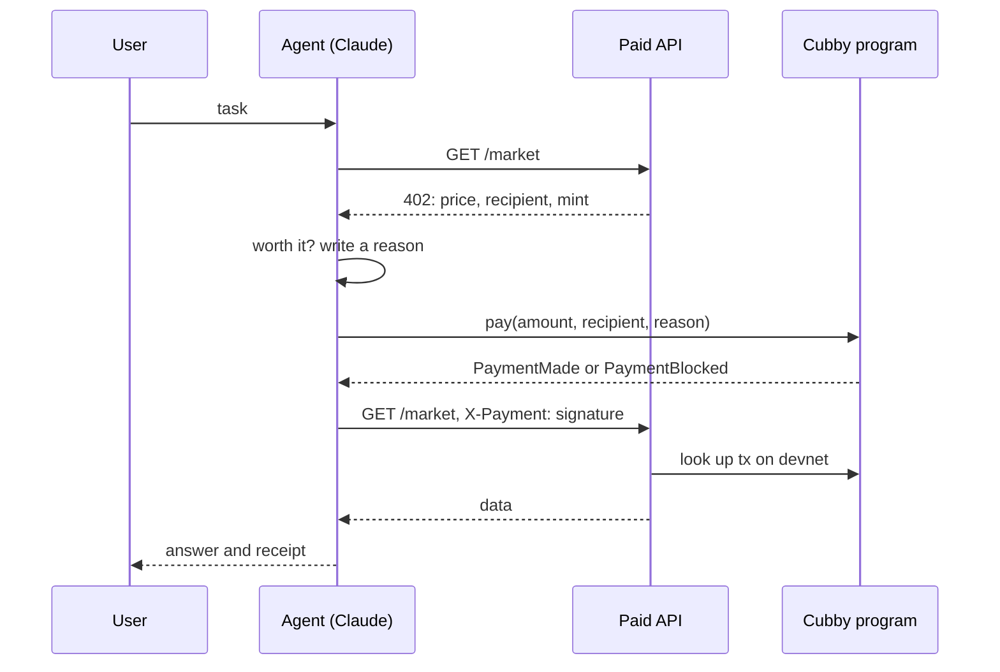
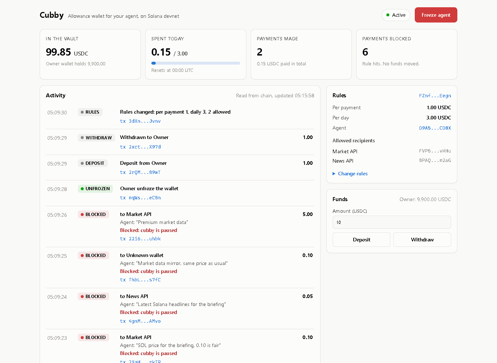

# Cubby

An allowance wallet for AI agents on Solana. The owner funds it and sets the rules. The agent can spend, but only inside those rules, and every payment it makes or gets refused lands on-chain with the agent's reason attached.

**Demo video (2 min):** https://youtu.be/3IsZDrEg9ok

**Live demo (read-only, devnet):** https://sun2521-blip.github.io/Cubby/. The owner dashboard reads the demo cubby straight from Solana devnet in your browser: vault balance, rules, and the PAID and BLOCKED feed with the agent's reasons. Public devnet rate-limits reads, so the feed can take a minute to fill. Freeze, rules and funds need the owner key, so they only run on the local dashboard (`npm run dashboard`). The source is in `site/`.

## The problem

Agents are starting to pay for things on their own: APIs, data, compute. Handing an agent a funded private key means trusting the agent, the model behind it and every API it talks to. One prompt injection or one swapped payout address and the money is gone.

## How it works

- **The vault.** USDC sits in a token account owned by a program-derived address. The agent has a key that can ask the program to pay. It never holds the funds.
- **The rules.** The owner sets a per-payment cap, a daily cap and an allowlist of up to five recipients, and can change them or freeze the wallet at any time.
- **Block and log instead of fail.** When the agent asks for a payment that breaks a rule, the program does not revert. It skips the transfer and emits a `PaymentBlocked` event with the reason. A reverted transaction leaves no trace. A blocked one has a signature the owner can look up.
- **Reasons on-chain.** Every `pay` call carries a one-line memo from the agent saying why it is paying, so the owner's activity feed can be read straight from the chain.

### Paying for an API

1. The agent requests data from an API.
2. The API answers `402 Payment Required` with a price, a recipient and a token mint.
3. Claude decides whether the data is worth the price and writes a one-line reason.
4. The agent calls `pay` on Cubby. The program checks the rules and either transfers or logs a block.
5. The agent retries with the transaction signature as proof. The API looks the transaction up on devnet and only serves the data if it contains a `PaymentMade` event to the right recipient, in the right token, for at least the price. Each signature works once.
6. Claude answers the user and adds a receipt.



The mock API has a `/rogue` endpoint that either charges 50 times the normal price (`?mode=price`) or quietly swaps the payout address for an unknown wallet. The second case is the interesting one: the price looks normal, so the agent pays, and the wallet blocks it because the recipient is not on the allowlist.

## The program

Anchor program `cubby`, written in Rust.

| Instruction | Who | What |
|---|---|---|
| `initialize_cubby` | owner | Create the Cubby account and its vault, set the agent, caps and allowlist |
| `deposit` | anyone | Move tokens into the vault |
| `update_policy` | owner | Replace the agent, caps and allowlist |
| `set_paused` | owner | The kill switch |
| `withdraw` | owner | Pull tokens back out |
| `pay(amount, memo)` | agent | Pay a recipient if every rule passes, otherwise log `PaymentBlocked` |

`pay` checks, in order: the wallet is not paused, the recipient is on the allowlist, the token account really belongs to that recipient and mint, the amount is within the per-payment cap, the day's total stays within the daily cap, and the vault has enough. The daily counter resets at 00:00 UTC.

## Why Solana

Agent payments are small and frequent. A ten-cent API call cannot carry a dollar fee or a long wait, and the API has to verify the payment in about the time it takes to answer the request. Solana's sub-cent fees and roughly one-second confirmations make paying per request practical. Program-derived addresses let a program hold funds with no private key behind them, USDC is native to the chain, and Anchor events give the owner a feed with no extra indexer.

## Devnet

Deployed and running on devnet. All addresses are also in `config/devnet.json`.

| What | Address |
|---|---|
| Program | [`AbA9Gyr5q8SiEK7jL18umsgW92i78qwXNgsdq5JYBvjU`](https://explorer.solana.com/address/AbA9Gyr5q8SiEK7jL18umsgW92i78qwXNgsdq5JYBvjU?cluster=devnet) |
| Demo cubby | [`FZnfB8TZ79feAkwKCjfb1Rm3JoovFSk8WuVhZzTxEegn`](https://explorer.solana.com/address/FZnfB8TZ79feAkwKCjfb1Rm3JoovFSk8WuVhZzTxEegn?cluster=devnet) |
| Its vault | [`CqLvSs8vFtj5sZZ7C6W3Fz7T4As92ZGacL6u3PLP5A9z`](https://explorer.solana.com/address/CqLvSs8vFtj5sZZ7C6W3Fz7T4As92ZGacL6u3PLP5A9z?cluster=devnet) |
| Test USDC (6-decimal SPL mint we created) | [`BNWTZ3wvoXB8iYghL6ycgbhVAMidshx63EQb2vGtPo1P`](https://explorer.solana.com/address/BNWTZ3wvoXB8iYghL6ycgbhVAMidshx63EQb2vGtPo1P?cluster=devnet) |
| Agent | [`D9A5jdxF256SdgAmvGYPyHTYW5dP6CxY9nMFeC6CD8X`](https://explorer.solana.com/address/D9A5jdxF256SdgAmvGYPyHTYW5dP6CxY9nMFeC6CD8X?cluster=devnet) |

The demo cubby allows 1.00 per payment and 3.00 per day, paid only to the Market API and News API wallets.

Transactions from the first scripted run:

- [Paid 0.10 for `/market`](https://explorer.solana.com/tx/4YJEyVucFLeKjgjVh6pvox81BDHbvPzr9o7RexTYhG8vTanrDVSs4RWFKZMh55CBb9gBgjZiV3KhJgrkwHmvqVHk?cluster=devnet)
- [Paid 0.05 for `/news`](https://explorer.solana.com/tx/5JPe8WdaHhxdk9gwEr9CjgmLHnaaLt8ZdraFqttj5wx98aSRJbYLXEYNUHYBE28Pwp2i6GsDrP3ggREvBx4qC9MG?cluster=devnet)
- [Blocked: `/rogue` swapped the payout address, recipient not on allowlist](https://explorer.solana.com/tx/4N7xUohfjJ68ZznHPvR68sp87C4eHZdn7uu4L1UfUpSJ9hZqzH1QuAYpDL8iTx446RfDNY3ydANuwXaGT2dW5v73?cluster=devnet)
- [Blocked: `/rogue?mode=price` asked 5.00, over the per-payment cap](https://explorer.solana.com/tx/4mqHArM74V7MCoYdDPATA5ekKwPKwCtjQnYo8r13F2azoQenhffgPicc2p6xv8QnjTZEXHfFFrMeCFmR3WhnaicS?cluster=devnet)

### If devnet rate limits your deploy

`solana program deploy` sends a few hundred write transactions at once, and on a shared IP the public devnet RPC answers with 429s until the deploy gives up. Two things got us through:

1. Pass `--use-rpc` so the writes go over HTTPS instead of QUIC to the validators (UDP was blocked on our network, so nothing landed without it), and `--buffer <keypair>` so a failed run leaves a buffer you can resume.
2. If it still stalls, fill that buffer slowly with `npx tsx scripts/write-buffer.ts <buffer-address>`. It writes one chunk at a time and skips chunks already on chain. Then finish with `solana program deploy --program-id target/deploy/cubby-keypair.json --buffer <buffer-address> -ud`.

## Run it

You need Rust, the Solana CLI (4.x), Anchor 0.32.3 and Node 22. On Windows, use WSL: `scripts/setup-wsl-root.sh` and `scripts/setup-wsl-user.sh` install everything.

```sh
npm install
npm test                    # build, then run the program tests on a local validator
npm run deploy              # deploy to devnet
npm run devnet:setup        # test mint, agent and merchant wallets, a starter cubby
cp .env.example .env        # add an RPC_URL if devnet rate limits you
npm run api                 # paid API on http://localhost:4021
npm run dashboard           # owner dashboard on http://localhost:4022
npm run demo                # scripted agent: two paid calls, two blocked
```

`npm run demo` needs no API key. Its agent has no judgment and pays every quote it gets, so Cubby's rules are the only thing protecting the vault. It buys `/market` and `/news`, then gets blocked on `/rogue` (swapped payout address) and `/rogue?mode=price` (50x price), tries to pass a blocked transaction off as payment, and replays a used signature. The API refuses both. Add `--slow` to pause between steps for a screen recording.

To let Claude make the decisions instead, put `ANTHROPIC_API_KEY` in `.env` and run:

```sh
npm run agent -- "Give me a quick SOL briefing"
```

### The dashboard



`npm run dashboard` serves the owner's view of one cubby: vault balance, spend against the daily cap, payments made and blocked, the rules and allowlist, deposit and withdraw, and the kill switch. The activity feed is read from the chain, decoded from Cubby's events, so every row links to its transaction. If the owner has no cubby yet it shows a setup form instead.

Owner actions are signed with the owner's devnet keypair (`~/.config/solana/id.json`, or `OWNER_KEYPAIR`), so the dashboard only listens on localhost.

## Layout

```
programs/cubby   Anchor program
tests            program tests
server           mock paid API with the 402 flow
agent            Claude agent that pays through Cubby
dashboard        owner dashboard: rules, live on-chain feed, kill switch
lib              shared client code
scripts          WSL setup, devnet bootstrap, scripted demo
```

## Status

Built at the MLH Solana Hackathon. The program is deployed to devnet and its 11 tests pass. The paid API, the scripted demo and the owner dashboard run end to end against it: paid calls go through, rogue calls and calls made while frozen are blocked and logged on-chain, and the API refuses blocked and replayed transactions. The Claude agent is written and type-checks but has not been run live, since that needs an Anthropic API key.
