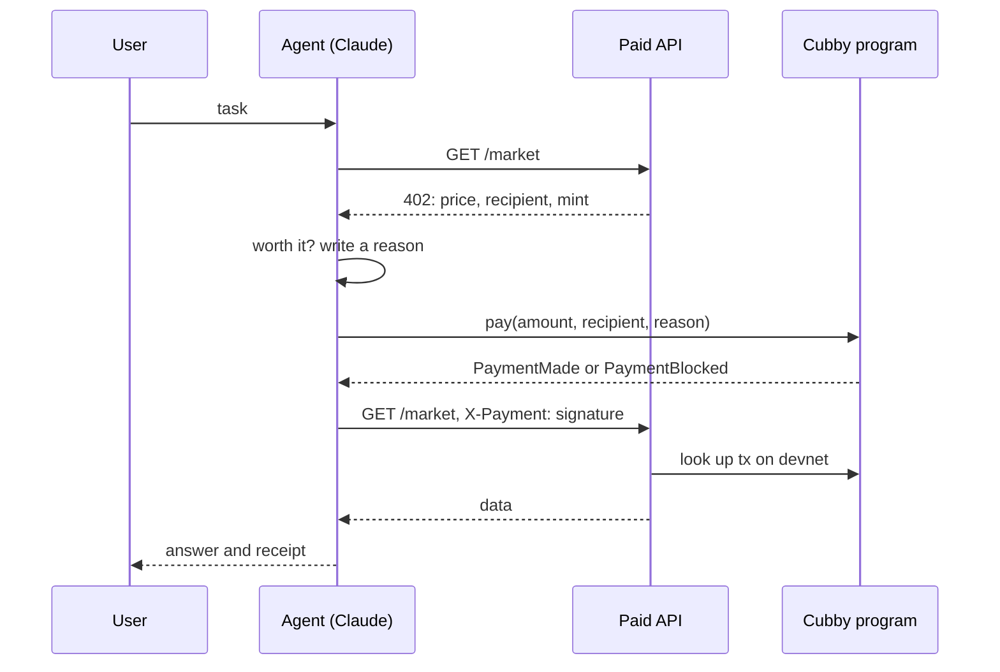

# Cubby

An allowance wallet for AI agents on Solana. The owner funds it and sets the rules. The agent can spend, but only inside those rules, and every payment it makes or gets refused lands on-chain with the agent's reason attached.

## The problem

Agents are starting to pay for things on their own: APIs, data, compute. Handing an agent a funded private key means trusting the agent, the model behind it and every API it talks to. One prompt injection or one swapped payout address and the money is gone.

## How it works

- **The vault.** USDC sits in a token account owned by a program-derived address. The agent has a key that can ask the program to pay. It never holds the funds.
- **The rules.** The owner sets a per-payment cap, a daily cap and an allowlist of up to five recipients, and can change them or freeze the wallet at any time.
- **Block and log instead of fail.** When the agent asks for a payment that breaks a rule, the program does not revert. It skips the transfer and emits a `PaymentBlocked` event with the reason. A reverted transaction leaves no trace. A blocked one has a signature the owner can look up.
- **Reasons on-chain.** Every `pay` call carries a one-line memo from the agent saying why it is paying, so the owner's activity feed can be read straight from the chain.

### Paying for an API

1. The agent requests data from an API.
2. The API answers `402 Payment Required` with a price, a recipient and a token mint.
3. Claude decides whether the data is worth the price and writes a one-line reason.
4. The agent calls `pay` on Cubby. The program checks the rules and either transfers or logs a block.
5. The agent retries with the transaction signature as proof. The API looks the transaction up on devnet and only serves the data if it contains a `PaymentMade` event to the right recipient, in the right token, for at least the price. Each signature works once.
6. Claude answers the user and adds a receipt.



The mock API has a `/rogue` endpoint that either charges 50 times the normal price (`?mode=price`) or quietly swaps the payout address for an unknown wallet. The second case is the interesting one: the price looks normal, so the agent pays, and the wallet blocks it because the recipient is not on the allowlist.

## The program

Anchor program `cubby`, written in Rust.

| Instruction | Who | What |
|---|---|---|
| `initialize_cubby` | owner | Create the Cubby account and its vault, set the agent, caps and allowlist |
| `deposit` | anyone | Move tokens into the vault |
| `update_policy` | owner | Replace the agent, caps and allowlist |
| `set_paused` | owner | The kill switch |
| `withdraw` | owner | Pull tokens back out |
| `pay(amount, memo)` | agent | Pay a recipient if every rule passes, otherwise log `PaymentBlocked` |

`pay` checks, in order: the wallet is not paused, the recipient is on the allowlist, the token account really belongs to that recipient and mint, the amount is within the per-payment cap, the day's total stays within the daily cap, and the vault has enough. The daily counter resets at 00:00 UTC.

## Why Solana

Agent payments are small and frequent. A ten-cent API call cannot carry a dollar fee or a long wait, and the API has to verify the payment in about the time it takes to answer the request. Solana's sub-cent fees and roughly one-second confirmations make paying per request practical. Program-derived addresses let a program hold funds with no private key behind them, USDC is native to the chain, and Anchor events give the owner a feed with no extra indexer.

## Devnet

- Program ID: `AbA9Gyr5q8SiEK7jL18umsgW92i78qwXNgsdq5JYBvjU`
- Token: a 6-decimal SPL mint we created as stand-in USDC. Addresses are in `config/devnet.json` after setup.

## Run it

You need Rust, the Solana CLI (4.x), Anchor 0.32.3 and Node 22. On Windows, use WSL: `scripts/setup-wsl-root.sh` and `scripts/setup-wsl-user.sh` install everything.

```sh
npm install
npm test                    # build, then run the program tests on a local validator
npm run deploy              # deploy to devnet
npm run devnet:setup        # test mint, agent and merchant wallets, a starter cubby
cp .env.example .env        # add ANTHROPIC_API_KEY, and an RPC_URL if devnet rate limits you
npm run api                 # paid API on http://localhost:4021
npm run agent -- "Give me a quick SOL briefing"
```

## Layout

```
programs/cubby   Anchor program
tests            program tests
server           mock paid API with the 402 flow
agent            Claude agent that pays through Cubby
lib              shared client code
scripts          WSL setup and devnet bootstrap
```

## Status

Built at the MLH Solana Hackathon. The program and its 11 tests are done. The agent and paid API are written and next up for end-to-end testing on devnet. The owner dashboard (setup, live feed, kill switch) comes after that.
